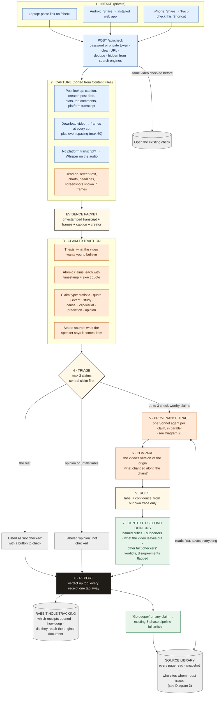
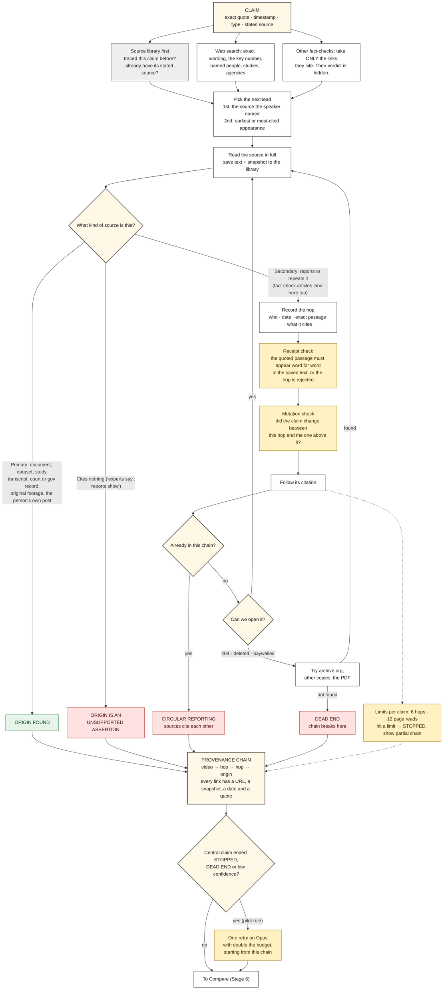
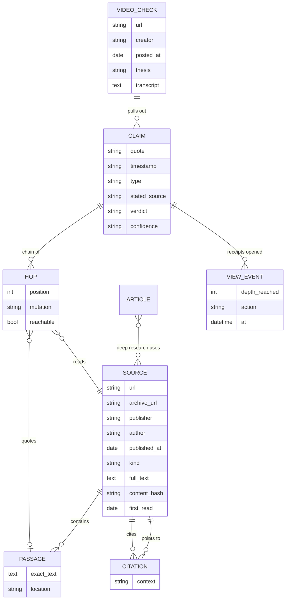

# Video Fact-Check: Research Flow

Status: **v0.4 built, not live yet** (code in `backend/factcheck/`, setup in `SETUP.md`). Last audited: 2026-10-30.

This is the source of truth for how the video fact-checker works. Edit the diagrams here, then re-render the images (see "Updating this map" at the bottom). Every change gets a line in the Changelog.

Images: `research-flow-overview.png` (diagram 1), `research-flow-trace.png` (diagram 2), `research-flow-library.png` (diagram 3).

## Principles

1. **Show every receipt.** The verdict is the hook, the receipts are the product. Every claim links to every source in its chain, with the exact passage, so the viewer can follow the rabbit hole themselves.
2. **Check for ourselves.** Other fact-checkers are never the authority. Their verdicts are hidden from our tracer and only shown afterward as a second opinion.
3. **Keep everything we read.** Every source is saved with a snapshot, so receipts never rot and each check makes the next one faster.

**Main success metric: rabbit hole depth.** Does the viewer open the receipts and keep going, or stop at the verdict?

---

## Diagram 1: Overview, link in to report out



**Legend:** blue = ported from Content Files · green = from the current Limbo research pipeline · orange = new for this tool · gray = storage.

---

## Diagram 2: The provenance trace (the core)

One of these runs for each check-worthy claim. The goal is a **chain**: the video, then each source that passed the claim along, down to where it actually started.



---

## Diagram 3: The source library (what we keep)

Every page any agent reads gets saved, not just the ones that make the final report. Over time this becomes a map of who cites whom, which is what makes later traces fast and what the future "dive into the documents" tool will run on.



---

## Stage by stage

### 1 · Intake (private)
- **iPhone:** a Shortcut in the share sheet. iOS does not let home-screen web apps appear in the share sheet (Android does), so the Shortcut is the only one-tap route. It POSTs the link to `/api/check` with a private token, then opens the result page. Same pattern as the Content Files "Save to Content Files" Shortcut.
- **Home screen:** add `/check` to the home screen so results open full-screen like an app. Later: push notification "Your check is ready" (works for home-screen web apps on iOS 16.4+).
- **Security (basic):** password login for `/check` and its results. The Shortcut uses a separate private token that is never shown on screen, so screen recordings don't leak it. `noindex` so search engines skip it. A daily cap on checks, so nobody can run up the bill. The existing public research pages are untouched.
- **Dedupe:** clean the URL (strip tracking params) so the same video shared twice opens the existing check.

### 2 · Capture (ported from Content Files into Limbo)
- Limbo stands alone: the Node code is rewritten in Python inside the Limbo app. Shares the ScrapeCreators account.
- Post lookup: caption, creator handle, post date, view/like counts, top comments, platform transcript.
- Download the video, grab frames at every scene cut plus even spacing.
- No transcript from the platform (Instagram stops at 2 min): extract audio, transcribe with Groq Whisper.
- **New:** read on-screen text, charts, screenshots of headlines or tweets shown in the video. These are often the actual claim.
- Output: one **evidence packet** with timestamps on everything.

### 3 · Claim extraction
- **Thesis:** one sentence on what the video wants you to believe. Individual claims can all be true while the thesis is not.
- **Atomic claims:** split compound sentences ("crime is up 40% because of X" = a statistic + a causal claim).
- Each claim keeps: timestamp, exact quote, type, and the **stated source** ("a Harvard study", "the CDC says", "this clip shows").
- Rule carried over from Content Files: use only what the evidence shows, never guess.

### 4 · Triage
- **Max 3 claims.** Most videos rest on one central claim, so that one is traced first and gets the most budget.
- Opinions, values and predictions are labeled as such, not "checked".
- Rank by: how central to the thesis × how checkable × how specific.
- Everything else is listed as "not checked" with a button to check it.

### 5 · Provenance trace (the core, see Diagram 2)
- Built on the current Phase 2 prompt ("trace every lead to its primary source") but with a structured **hop log** instead of a flat list.
- **Library first:** if we have traced this claim or read its stated source before, start from there.
- Each hop records: URL, publisher, author, date, source type, the exact passage, what it cites next, and whether it was reachable.
- Four ways a trace ends: **origin found**, **unsupported assertion**, **circular reporting**, **dead end**. Plus **stopped** when it hits the limit.

#### How other fact-checkers are used (and not used)
- **As a map, not a verdict.** Fact-check articles often link straight to the primary documents. The tracer gets those links as leads, the same as any search result. Their rating ("False", "Misleading") is removed before the tracer sees it, so it can't anchor our conclusion.
- **As a hop like any other.** If a fact-check article is itself part of how a claim spread, it shows up in the chain as a secondary source and gets the same mutation check as everyone else.
- **As a second opinion, after the fact.** Once our verdict is set, their verdicts are shown next to ours in Stage 7. When we disagree, that's flagged and explained, with receipts for both.
- **Never required.** The trace runs fully without them. Most viral claims have no fact-check anyway.

### 6 · Compare: video vs origin
The mutation check, run on every link in the chain. The common ways claims change as they travel:

| Mutation | Example |
|---|---|
| Number changed | 14% becomes "nearly 20%" |
| Scope widened | "in 3 states" becomes "nationwide" |
| Hedge dropped | "may be linked" becomes "causes" |
| Time shifted | 2019 data presented as current |
| Correlation → causation | "rose at the same time" becomes "because of" |
| Quote clipped | sentence cut before the "but" |
| Misattributed | said by a staffer, credited to the senator |
| Wrong clip | real footage from a different event or year |
| Cherry-picked | one study out of many that disagree |

The **verdict** comes only from our own chain and this comparison.

### 7 · Context + second opinions (borrowed from Phase 3, lighter)
- At least one named critic and one named supporter, with quotes and links. Same rule as Phase 3: a one-sided result is incomplete.
- **What the video leaves out:** the context a viewer would need to judge it.
- **Other fact-checkers' verdicts**, shown after ours, with disagreements flagged.

### 8 · Report (what you see on your phone)
- Top: the thesis and the verdict label for the central claim. The label gives an immediate answer and points straight at the receipts.
- One card per claim: the quote and timestamp, a verdict chip, and the chain as a vertical ladder (video → hop → origin). Every rung opens the exact passage, highlighted, with links to the live page and our saved snapshot.
- Verdict chips describe the relationship to the origin: **Matches origin · Stretched · Missing context · Misattributed · Outdated · Contradicted by origin · No origin found · Opinion**. Each with a confidence level.
- Unknowns are stated plainly.
- Results appear progressively: claims show up first (~30 s), verdicts fill in as each trace finishes.
- "Go deeper" on any claim sends it to the existing 3-phase pipeline for a full article.

---

## The source library

**What we have now:** each research article keeps a list of its primary sources (URL + one-line summary) inside its own JSON file. 23 sources across the current articles. The full text of everything the agents read is thrown away after use, and pages they read but didn't cite aren't recorded at all.

**What we keep from now on (Diagram 3):**
- **Every source read**, cited or not: URL, publisher, author, publish date, source type, full text, a content hash (so we notice if a page is edited later), and when we first read it.
- **A snapshot** of each source: our own saved copy, plus a Wayback Machine capture so public receipts survive link rot and deletions. Original documents (PDFs, datasets) are saved as files.
- **Passages:** the exact text each hop quoted, with its location, so receipts open to the highlighted line.
- **Citations:** source A cites source B. This builds a map of who cites whom across every check. Circular reporting and common origins show up on their own over time.
- **Claims and chains:** every traced claim, linked to other videos making the same claim.
- **Backfill:** the 23 sources from existing articles get imported, and the deep-research pipeline saves into the same library.

**Why it pays off:**
- Faster, cheaper checks: a claim or source we've seen is a lookup, not a new search.
- Better process: we can audit which source types end in dead ends, which publishers drop hedges, where traces burn budget.
- The future document-dive tool: guided reading through the primary documents, based on what the viewer is investigating.

**Where it lives:** a SQLite database with full-text search on the existing Railway volume (`DATA_DIR`), with files alongside it. No new service or cost. Move to Postgres when the site goes public. Snapshots are for research and receipts. Publicly we show excerpts and link to the original plus its archive copy.

---

## Rabbit hole tracking (the success metric)

Logged from day one, per check and per claim:
- Did they open any receipt at all?
- **Depth reached:** the furthest rung of the chain they opened (0 = verdict only, last rung = the origin itself).
- Did they open the original document, the live page or the snapshot?
- Time spent on receipts vs on the verdict.
- Did they tap "go deeper" or "check" on an unchecked claim?

Headline number: **share of checks where the viewer reached the origin.**

---

## Decisions

- **2026-10-30** Max 3 claims per video, central claim first.
- **2026-10-30** Verdict labels yes, always paired with the full receipt chain.
- **2026-10-30** Other fact-checkers are leads and second opinions only, never the verdict.
- **2026-10-30** Basic security on the fact-check section before the share route goes live.
- **2026-10-30** Limbo stands alone: capture code is ported into the Python app.
- **2026-10-30** Keep every source read in a source library.
- **2026-10-30** Pilot with Sonnet tracers and capped budgets. "Go deeper" runs the full Opus pipeline. Accuracy gets tested against deep manual research before we trust it (see Pilot evaluation).

## Open questions

1. **Auto-retry on Opus** (proposed, in Diagram 2): when the central claim's trace stops at the limit, dead-ends or is low confidence, retry once on Opus. Keep or drop based on the pilot evaluation.
2. **Visual claims.** Checking whether a clip is from a different event needs reverse image search on key frames. No good free API; parked.
3. **Claim library freshness.** How old can a past trace be before we re-run it? Proposed: reuse the chain, but re-check reachability and look for newer sources after 30 days.

---

## Pilot evaluation: is Sonnet thorough enough?

The worry: a faster, cheaper model with a step limit might stop at a news article instead of reaching the real origin, or miss where the claim changed. We test that directly instead of guessing.

### Built-in safeguards (in the pilot from day one)
- **Receipt check.** Every quoted passage must appear word for word in the saved text of its source. A hop that fails is rejected. This is automatic, so a made-up or paraphrased receipt can never reach the report.
- **Central claim gets the most budget.** Claims 2 and 3 get less.
- **Honest endings.** A trace that runs out of budget says STOPPED and shows the partial chain. It never presents a news article as the origin.
- **Auto-retry on Opus** for the central claim when the trace ends badly (proposed, see Open questions).

### The gold set
- **10 videos** to start, picked to cover different claim types: a statistic, a quote, a study, a clip used out of context, a causal claim, a claim that turns out true, and a few political ones from both directions.
- For each video, **deep manual research** builds the answer key: the central claim, the full chain, the true origin, every mutation, and the verdict. Done by Skye with Claude's full research, not by the pipeline being tested.
- Answer keys live in `docs/fact-check/eval/gold/`, one file per video.

### Three runs per video
Running three versions separates "the model isn't good enough" from "the budget is too small":

| Run | Model | Budget |
|---|---|---|
| A · pilot | Sonnet | 6 hops · 12 reads |
| B · more budget | Sonnet | 12 hops · 30 reads |
| C · bigger model | Opus | 6 hops · 12 reads |

If B catches up to the gold set, raise the budget. If only C does, use Opus for tracing (or for the central claim).

### Scoring each run against the answer key

| Measure | Question |
|---|---|
| Claim pick | Did it pick the same central claim? |
| Origin reached | Same origin as the answer key? (exact · stopped one hop short · wrong origin · none) |
| Hops missed | How many steps of the gold chain did it skip? |
| Mutations caught | Of the changes in the answer key, how many did it find? |
| Verdict match | Same verdict label? |
| Receipt validity | Share of receipts that pass the word-for-word check (target: 100%) |
| False confidence | Did it say "high confidence" on a wrong answer? (the worst error) |
| Time and cost | Seconds to full result, dollars per check |

**Pass bar for the pilot** (proposed): origin reached on at least 8 of 10 central claims, verdict match on at least 8 of 10, zero false-confidence errors, 100% receipt validity.

### Keeping score over time
Results go in `docs/fact-check/eval/scoreboard.md`, one row per run. The gold set gets re-run after every prompt or budget change, so we can see whether a change made things better or worse. Videos where the pilot failed become the most useful additions to the set.

---

## Audit checklist

Run this against 3 to 5 real checks each time we audit.

- [ ] Were the right claims picked? Was the central claim first?
- [ ] Did each chain reach a true primary source, or stop at a news article?
- [ ] Is every hop backed by a URL, a snapshot and an exact passage (no paraphrase-only hops)?
- [ ] Did the mutation check catch the change, if there was one?
- [ ] Did our verdict come from our own chain? Where we disagree with other fact-checkers, is the reason clear?
- [ ] Were verdicts fair to the creator? Would they agree we quoted them accurately?
- [ ] Do counterpoints include named people on both sides?
- [ ] How many sources came from the library vs fresh searches?
- [ ] Rabbit hole depth for these checks.
- [ ] Time from share to first result, and to full result.
- [ ] Cost per check.

---

## Changelog

- **2026-10-30 · v0.4** Built. Every stage in this map is implemented (see the code table in SETUP.md). Passes 47 offline checks and a 17-check end-to-end pipeline test with a scripted stand-in for Claude. Not yet run against real videos and the real web: first real runs happen on Railway after the variables are set. Built-in details not shown in the diagrams: every agent action is saved to a per-check research log; pages that change after we save them are flagged; up to 16 frames per video (opening, every cut, then even spacing).

- **2026-10-30 · v0.3** Sonnet pilot decided. Added the receipt check and proposed Opus retry to Diagram 2. Added the Pilot evaluation plan (gold set, three runs, scoring, pass bar).
- **2026-10-30 · v0.2** Max 3 claims. Fact-checkers moved to leads (verdict hidden) and second opinions after our verdict. Added the source library (Diagram 3), snapshots, rabbit hole tracking, basic security. Capture code to be ported into Limbo.
- **2026-10-30 · v0.1** First draft. Built from the current research pipeline (`backend/research_pipeline.py`) and the Content Files video pipeline.

---

## Updating this map

The diagrams above are Mermaid. They render in GitHub, VS Code (with a Mermaid extension) and Obsidian. After editing, re-render the PNGs:

```
npx -y @mermaid-js/mermaid-cli -i research-flow.md -o research-flow.png -b white -s 2
```

That writes one PNG per diagram (`research-flow-1.png` to `-3.png`); rename them to `research-flow-overview.png`, `research-flow-trace.png` and `research-flow-library.png`. Or just ask Claude to update and re-render.
